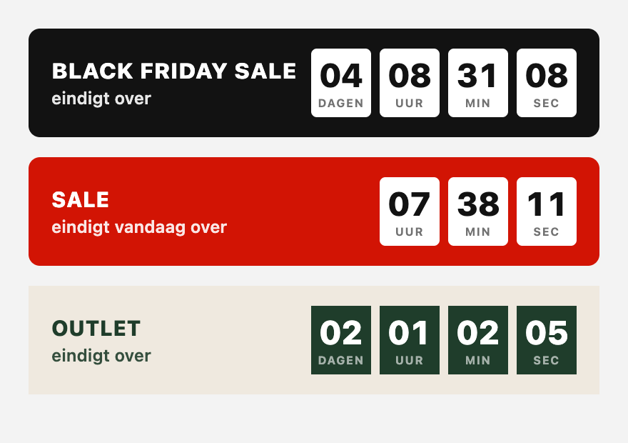
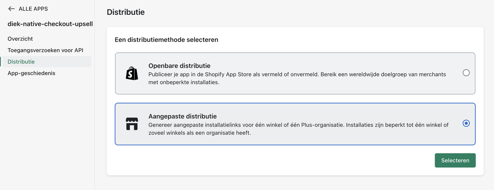
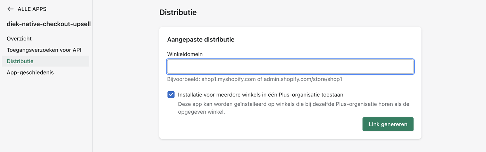

<a href="https://diek.nl"><picture><source media="(prefers-color-scheme: dark)" srcset="docs/diek-logo-white.svg"></picture></a>

# Aftelklok in je Shopify-checkout, zonder countdown-app

Gemaakt door [DIEK](https://diek.nl), full-stack Shopify (Plus) development uit Nijmegen. Gratis en open source, doe ermee wat je wilt.



## Wat is dit?

Een klein blok voor je Shopify-checkout dat aftelt naar het einde van je actie: "BLACK FRIDAY SALE, eindigt over 04 dagen 08 uur 31 min 08 sec". Je kiest zelf de tekst, het eindmoment en de kleuren. Na het einde verdwijnt het blok vanzelf.

Daar bestaan apps voor. Die kosten per maand, laden extra code en bewaren je instellingen op hun servers. Dit blok heeft geen server, geen abonnement en geen toegang tot je shopgegevens.

## Wat heb je nodig?

- Een Shopify-shop.
- Voor het blok **in de checkout**: **Shopify Plus**. Dat is een regel van Shopify en geldt voor elke app die daar iets wil tonen.
- Voor het blok **op de bedankpagina**: elk plan vanaf Basic.
- Iemand die één keer vijf minuten de installatie doet. Daarna beheer je alles in de checkout-editor, zonder developer.

## Installeren in vijf stappen

Je hebt een computer nodig met [Node.js](https://nodejs.org) (versie 20 of nieuwer). Geen ervaring met de terminal? Laat een AI-agent het doen.

**Liever een AI-agent laten installeren?** Open een terminal met [Claude Code](https://claude.com/claude-code) of [Codex](https://openai.com/codex) en plak dit:

```text
Clone https://github.com/Diek-nl/shopify-native-checkout-countdown.git en installeer deze
Shopify-app op mijn shop. Volg README.md en AGENTS.md. Doe het terminalwerk zelf
(npm install, config:link, deploy), laat mij inloggen als dat nodig is, en geef me
daarna de klikstappen voor het Dev Dashboard en de checkout-editor.
```

**1. Haal de code binnen**

```bash
git clone https://github.com/Diek-nl/shopify-native-checkout-countdown.git
cd shopify-native-checkout-countdown
npm install
```

**2. Koppel het aan je shop**

```bash
npm run config:link
```

Log in bij Shopify, kies je organisatie en kies "Create this project as a new app". Dit maakt een app aan in je eigen Shopify-account; hij komt niet in de App Store.

**3. Test hem eerst** (optioneel)

```bash
npm run dev
```

**4. Zet hem op de shop**

```bash
npm run deploy
```

De code staat nu bij Shopify, maar nog niet op je shop. Koppel de app één keer als **aangepaste distributie**:

1. Open de app in het [Dev Dashboard](https://dev.shopify.com/dashboard) (of het [Partner Dashboard](https://partners.shopify.com)).
2. Klik op **Distributie**, kies **Aangepaste distributie** en klik op **Selecteren**.



3. Vul het adres van je shop in (`jouwshop.myshopify.com`) en klik op **Link genereren**.



4. Open die link en klik op **Installeren**.

Op een development store sla je de distributie over en klik je op de app-pagina op **Install app**.

**5. Zet het blok op zijn plek**

In je Shopify-admin: **Instellingen → Checkout → Aanpassen**. Klik op **App-blok toevoegen**, kies "Aftelklok" en sleep hem waar je hem wilt, bijvoorbeeld boven de artikelen in de bestelsamenvatting. Vul bij de blokinstellingen het **einde van de actie** in (zonder einde toont het blok niets) en klik op **Opslaan**.

## Instellingen

| Instelling | Standaard | Wat het doet |
|---|---|---|
| Einde van de actie | leeg (verplicht) | Datum en tijd met tijdzone, bijvoorbeeld `2026-12-01T00:00:00+01:00` voor 30 november 23:59 Nederlandse tijd. In de zomertijd `+02:00` |
| Kop | Sale | De vette regel, bijvoorbeeld "Black Friday sale" |
| Regel onder de kop | eindigt over | Leeg = vertaald (NL, EN, DE, FR). Een eigen tekst geldt voor alle talen |
| Alleen de laatste … uur tonen | altijd | 24 = alleen de laatste dag, 72 = de laatste drie dagen |
| Kleur van het vlak | `#121212` | Hex-kleur van de achtergrond |
| Kleur van de tekst | `#FFFFFF` | Kop en regel |
| Kleur van de vakjes | `#FFFFFF` | De vakjes achter de cijfers |
| Kleur van de cijfers | `#121212` | Cijfers en labels |
| Ronde hoeken | 8 | 0 tot 20; 0 = recht |

Op de laatste dag vervalt het dagen-vakje en blijven uren, minuten en seconden over.

## Ik zie het blok niet, wat nu?

- **Is "Einde van de actie" ingevuld en leesbaar?** Gebruik precies de notatie `2026-12-01T00:00:00+01:00`. In de editor zegt het blok het als het einde ontbreekt.
- **Ligt het einde in het verleden?** Dan toont het blok niets.
- **Staat "Alleen de laatste … uur tonen" ingevuld?** Dan verschijnt hij pas in dat venster.
- **Heb je op Opslaan geklikt** in de checkout-editor?
- **Sta je in de checkout zonder Shopify Plus?** Daar kan het niet. Gebruik dan de bedankpagina.

## Wat dit bewust niet doet

- **Geen nep-urgentie.** Geen klok die per bezoeker opnieuw begint of elke dag terugspringt. Hij telt af naar één echt eindmoment, voor iedereen hetzelfde.
- **Geen korting.** De klok laat alleen zien wanneer je actie stopt. De actie zelf regel je in Shopify (kortingen of prijzen) en moet je zelf op dat moment laten eindigen.
- **Geen tracking, geen netwerkverkeer.** Het blok leest alleen zijn eigen instellingen.

## Wat kost het?

Niets. Geen abonnement, geen kosten per order. De code is van jou zodra je hem hebt gedownload (MIT-licentie).

---

## Voor developers

Extension-only app, geen backend, geen scopes. Eén Checkout UI Extension (Preact + Polaris web components, API 2026-01) met twee targets: `purchase.checkout.block.render` en `purchase.thank-you.block.render`.

Checkout-componenten kennen geen eigen kleuren en geen grote vette cijfers. Daarom tekent het blok de klok als **SVG** en toont die als data-URI in één `s-image`, elke seconde opnieuw opgebouwd; de tekst voor schermlezers staat in `alt`. Kleuren uit de instellingen gaan alleen door als ze een geldige hex-kleur zijn.

```
shopify.app.toml                      app-config (template; config:link vult client_id)
extensions/checkout-countdown/
  shopify.extension.toml              targets + instellingen
  src/klok.ts                         rekenwerk: einde, resterende tijd, kleuren
  src/banner.ts                       de SVG
  src/Countdown.tsx                   het blok
  locales/                            en (standaard), nl, de, fr
  test/klok.test.ts                   node --test
```

`npm run typecheck` en `npm test` (Node 22.6 of nieuwer voor de tests) draaien over de extensie.

**Eigen lettertype?** Een SVG-afbeelding mag geen externe lettertypes laden. Zet je lettertype als base64-woff2 in een `@font-face` binnen `<defs><style>` in `src/banner.ts` en verwijs ernaar met `font-family`. Breng het eerst terug tot de tekens die je gebruikt (`pyftsubset font.woff2 --text="ABC…0123456789" --flavor=woff2`), anders wordt de afbeelding onnodig zwaar. Let op de licentie van het lettertype.

**Meer talen?** Voeg een bestand toe in `locales/` (bijvoorbeeld `it.json`) met dezelfde sleutels.

## Over DIEK


Ik ben Diek Thunnissen, oprichter van [DIEK](https://diek.nl). We doen full-stack Shopify (Plus) development vanuit Nijmegen: bouwen, migreren, optimaliseren en doorontwikkelen.

Dit blok is een uitgeklede versie van wat we voor klanten in de checkout bouwen: klokken in de eigen huisstijl en het eigen lettertype, upsells, cadeaudrempels, pre-order-logica. Allemaal op Shopify's eigen bouwblokken, zonder apps op het kritieke pad.

Wil je dit in jouw checkout laten zetten, of iets dat verder gaat? Mail [info@diek.nl](mailto:info@diek.nl), stuur een bericht via [diek.nl/contact](https://diek.nl/contact) of op [LinkedIn](https://www.linkedin.com/in/de-shopify-expert/).

## Licentie

MIT. Copyright 2026 Diek Thunnissen / DIEK.

---

## English summary

A single Shopify Checkout UI Extension that shows a **countdown to the end of your promotion** in checkout (Shopify Plus) and on the thank-you page (all plans from Basic). You set the end moment, the text and the colours in the checkout editor. The clock is drawn as an SVG inside one `s-image`, because checkout components have no custom colours. No backend, no scopes, no network calls, no subscription. Setup: `npm install`, `npm run config:link`, `npm run deploy`, install via custom distribution, add the "Aftelklok" block in the checkout editor and fill in the end date (`2026-12-01T00:00:00+01:00`). MIT, by [DIEK](https://diek.nl).
